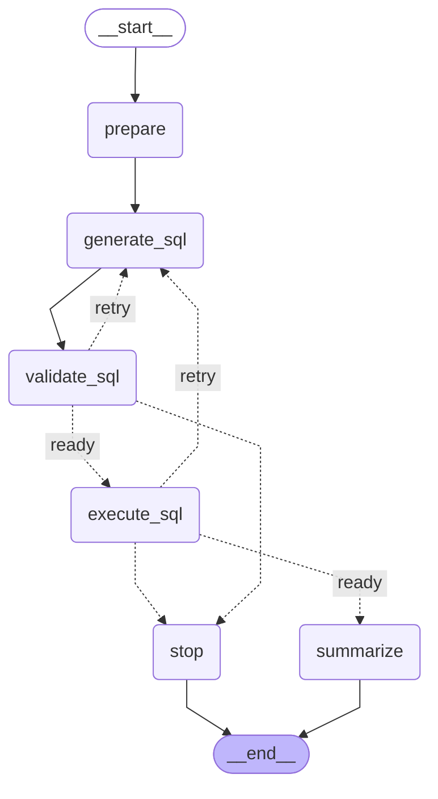

# Lesson 1: A fixed SQL workflow

Your LangGraph workshop skills apply directly to this example.
The graph defines the allowed steps. Each model call performs one small task.
Python validates model output and chooses each permitted branch.

The notebooks and their matching `.py` scripts use `create_agent`.
[L1_fast_agent_llm.py](L1_fast_agent_llm.py) provides the separate fixed workflow example.

## Run and read the example

From the `python` directory:

```bash
uv sync --locked
uv run python L1_fast_agent_llm.py
```

1. Read `build_graph` in `L1_fast_agent_llm.py` to see the nodes and edges.
2. Read `SQLState` in [llm_workflows.py](llm_workflows.py) to see the stored fields.
3. Read `SQLNodes` in the same file to see each node's code.
4. Run the setup cell to print the state diagram.
5. Run the question cell to see updates from each node.

The example loads the schema, generates SQL, validates SQL, executes SQL, and summarizes the results.
The model returns SQL text and a summary. Python controls the database operations and graph branches.
An invalid query or execution error permits one correction by default.
After two failed drafts, the graph stops without another model call.

## Map your workshop skills

| Workshop skill | Use in Lesson 1 |
| --- | --- |
| `TypedDict` state | Store the question, schema, SQL, results, and errors in `SQLState` |
| Node functions | Return state updates from each method in `SQLNodes` |
| `add_edge` | Require the next step in the SQL workflow |
| `add_conditional_edges` | Choose success, retry, or stop from errors and attempt counts |
| Runtime context | Supply the database through `SQLContext` |
| Stream modes | Show each node's updates with `stream_mode="updates"` |

## Shared model settings

`create_workflow_model` in [llm.py](llm.py) uses the shared OpenRouter endpoint and default model.
Set `OPENROUTER_API_KEY` in `python/.env`.
Set `LLM_MODEL` in that file to select another OpenRouter model.

```dotenv
LLM_MODEL=provider/model
```

Replace `provider/model` with your selected OpenRouter model ID.
The client uses `temperature=0`, a 45-second timeout, and one transport retry.
Transport retries are separate from graph correction attempts.
The normal path makes two model calls. One correction increases that total to three.

The graph has fixed routes, but model text can still vary.
Validation checks syntax and permitted operations. Validation does not prove that an answer is correct.

## SQL controls

The example supports SQLite database files.
Separate connections use `mode=ro`. SQLite authorization rejects write operations.
Each query must be one `SELECT` or read-only `WITH` statement of at most 4096 characters.
Validation compiles the query with `EXPLAIN`. Execution applies the checks again.
Results contain at most five rows, with text values shortened to 300 characters.
A progress handler stops long queries after roughly 100,000 SQLite virtual-machine operations.

## Check the example offline

```bash
uv run python -m unittest discover -s tests -v
```

The tests run the graph and real SQLite queries with offline model replies.
The tests also check the shared model settings. They make no live OpenRouter requests.

## State diagram

This diagram comes from the compiled graph.

[L1_fast_agent_llm.py](L1_fast_agent_llm.py)



Success path: `prepare -> generate_sql -> validate_sql -> execute_sql -> summarize`.
