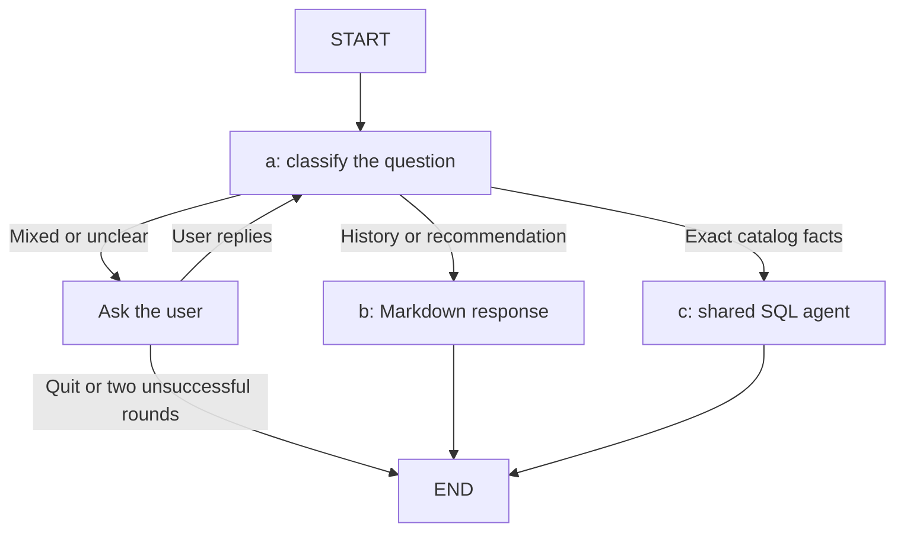

# 🔗 LangChain Essentials Python

## Introduction

This repository is the companion to the course located [HERE](https://academy.langchain.com/courses/langchain-essentials-python).

Please refer to the following sections to prepare your system to run the notebooks provided.

**Note**: If you choose a different model from what is used in the notebook you may get unexpected results.

---

## 🚀 Setup

### Prerequisites

- The [Chrome](https://www.google.com/chrome/) browser is recommended
- [git](https://git-scm.com/install/) is recommended
- [uv](https://docs.astral.sh/uv/) package manager (includes `uvx`, required by notebook 5)
- The course requires Python >=3.11, <3.14. `uv` will take care of this for you.

### Installation

Download the course repository

```bash
# Clone the repo, cd to 'python' directory
git clone https://github.com/langchain-ai/lca-langchainV1-essentials.git
cd ./lca-langchainV1-essentials/python
```

Make a copy of example.env

```bash
# Create .env file
cp example.env .env
```

Add an [OpenRouter](https://openrouter.ai/keys) API key to `.env`.
Add a [LangSmith](#getting-started-with-langsmith) API key if you want tracing.

```bash
# Add OpenRouter API key
OPENROUTER_API_KEY=your_openrouter_api_key_here

# Optional API key for LangSmith tracing
LANGSMITH_API_KEY=your_langsmith_api_key_here
LANGSMITH_TRACING=true
LANGSMITH_PROJECT=langchain-py-essentials
# If you are on the EU instance:
LANGSMITH_ENDPOINT=https://eu.api.smith.langchain.com

```

All lesson and Studio agents use OpenRouter's OpenAI-compatible endpoint:
`https://openrouter.ai/api/v1`.
The default model is `deepseek/deepseek-v4.1-flash`.
All notebooks, scripts, and Studio agents share their model setup in [llm.py](llm.py).
Change `OPENROUTER_BASE_URL` or `DEFAULT_MODEL` in that file to update the shared defaults.
Set `LLM_MODEL` in `.env` to override the default model.

```python
from llm import create_model

llm = create_model()
```

The Lesson 1 fixed workflow uses `create_workflow_model()` from the same file.
That function keeps `temperature=0`, a 45-second timeout, and one transport retry.
Both functions load `python/.env` and keep existing environment values.

Make a virtual environment and install dependencies
```bash
# Create virtual environment and install dependencies
uv sync
```

### Run the interactive Python scripts

Each lesson notebook has a matching `<original-name>.py` script that uses `create_agent`.
Lesson 1 also has `L1_fast_agent_llm.py`, which uses an explicit state graph.
`L1_fast_agent_state.py` shows a state graph with a `create_agent` SQL agent inside one branch.
All lesson scripts use `# %%` cells.
Run the cells in order because later cells use variables from earlier cells.

The Lesson 1 fixed workflow uses required steps and code-controlled validation, retries, and SQL execution.
The model performs small tasks inside nodes. The model cannot choose tools or the next state.
Start with [L1_fast_agent_llm.py](L1_fast_agent_llm.py).
See the [Lesson 1 guide and state diagram](LLM_WORKFLOWS.md) to connect this example with your LangGraph workshop.

1. Run `uv sync --locked` in the `python` directory.
2. Open a lesson script, such as `L1_fast_agent_llm.py`.
3. Select the project environment in your editor.
4. Run the cells from top to bottom.

In VS Code, install the Python and Jupyter extensions.
Select `python/.venv/bin/python` as the kernel for the Python Interactive window.
On Windows, select `python/.venv/Scripts/python.exe`.
Use **Run Cell** above each code cell, or press **Shift+Enter** inside the cell.

In Spyder, select the same Python environment.
The selected environment must include the compatible `spyder-kernels` version that Spyder requests.
Replace `<requested-version>` with that version in this command:

```bash
uv add --dev "spyder-kernels==<requested-version>"
```

Press **Shift+Enter** to run a cell and move to the next cell.

The project includes `ipykernel` for the VS Code kernel.
Kernel registration is optional if your editor can select the environment directly.
To register the kernel within the project environment, run:

```bash
uv run python -m ipykernel install --sys-prefix --name langchain-essentials --display-name "LangChain Essentials"
```

To run a whole lesson from the terminal:

```bash
uv run python L1_fast_agent_llm.py
```

The fixed workflow in `L1_fast_agent_llm.py` generates, validates, and executes SQL in separate required nodes.

To run the music graph with Markdown, SQL, and user clarification:

```bash
uv run python L1_fast_agent_state.py
```

Node `a` makes one model call to classify a natural question.
Python validates the result and returns `Command(update=..., goto=...)`.
The accepted destinations are `b`, `c`, and `clarify`.
Invalid model output also selects clarification.
The model's classification can vary. Python controls the permitted transitions and call limits.



Both `b` and `c` exist in the same graph. A question selects one source.
All node functions are outside `build_graph`.

The fictional sources are in `studio`:

- [lesson_notes.md](studio/lesson_notes.md) contains prose about albums, singers, and genre histories.
- [music_history_skill.md](studio/music_history_skill.md) contains separate response instructions.
- [music_catalog.db](studio/music_catalog.db) contains matching artists, genres, albums, and tracks.
- [music_catalog.sql](studio/music_catalog.sql) is the readable seed for that database.

“Recommend an album for a quiet evening” should select `b`.
“Why did Mira Vale make Evening Lines?” should also select `b`.
Node `b` reads the two Markdown files and makes one model call without tools.
Its instructions require answers from the Markdown only.
If the history lacks the answer, it should say it is not able to answer.
The source folder comes from `RuntimeContext.markdown_root`, which defaults to `studio`.

“What is the price and artist of Evening Lines?” should select `c`.
The top-level `node_c` invokes the shared SQL agent with the question and runtime context.
The agent discovers schema and queries data through one read-only tool.
Each SQL run allows three agent model calls and two tool executions.
The classifier call has a separate budget.

A question requiring both sources selects `clarify`.
That node uses `interrupt()` to pause for a reply.
Resume with `Command(resume=reply)` using the same thread ID and runtime context.
The reply returns the graph to `a`, with the original question and clarification history.
The latest reply can narrow the request to one source.
After two replies, a request that remains unclear goes to `END`.
Blank replies count toward that limit.
Typing `quit` ends the request immediately.

```python
config = {"configurable": {"thread_id": "music-question-1"}}
result = graph.invoke(
    {"question": "Recommend an album and list exact track durations."},
    config=config,
    context=context,
)
if result.get("__interrupt__"):
    print(result["__interrupt__"][0].value["question"])
    result = graph.invoke(
        Command(resume="Only recommend a calm album."),
        config=config,
        context=context,
    )
```

`build_graph` creates one shared model, one SQL agent, and one checkpointer.
The `@tool` definition creates the SQL tool once when the module loads.
Nodes reuse these objects across requests and clarification replies.
The example cells also create the database object once.
Use a new thread ID for each new question.
The in-memory checkpointer keeps paused state only while the Python process runs.
All model calls use the shared setup in `llm.py` and need `OPENROUTER_API_KEY`.

To check both graphs with real SQLite queries and simulated model replies:

```bash
uv run python -m unittest discover -s tests -v
```

To run the whole lesson and then open a Python REPL with its variables:

```bash
uv run python -i L2_messages.py
```

Whole-file execution runs every example, including the practice cells.
The scripts use OpenRouter and need `OPENROUTER_API_KEY` in `.env`.
Model requests can incur API charges.
The scripts find `.env` and `Chinook.db` beside the script.
If the interactive console does not set `__file__`, start from the repository root or the `python` directory.

`L1_fast_agent_llm.py` prints its state graph as Mermaid text.

Run notebooks

```bash
# Run Jupyter notebooks directly with uv
uv run jupyter lab

# Or activate the virtual environment if preferred
source .venv/bin/activate  # On Windows: .venv\Scripts\activate
jupyter lab
```

Optional: Setup [LangSmith Studio](https://docs.langchain.com/oss/python/langchain/studio)

```bash
# copy the .env file you created above to the studio directory
cp .env ./studio/.
cd studio
#to run with uv
uv run langgraph dev
#to run with virtual env
langgraph dev
```

### Getting Started with LangSmith

- Create a [LangSmith](https://smith.langchain.com/) account
- Create a LangSmith API key


# 📚 Lessons
This repository contains nine short notebooks that serve as brief introductions to many of the most-used features in LangChain, starting with the new **Create Agent**.

---

### `L1_fast_agent.ipynb` - 🤖 Create Agent 🤖
- In this notebook, you will use LangChain’s `create_agent` to build an SQL agent in just a few lines of code.  
- It demonstrates how quick and easy it is to build a powerful agent. You can easily take this agent and apply it to your own project. 
- You will also use **LangSmith Studio**, a handy visual debugger to run, host, and explore agents.

---

### `L2-7.ipynb` - 🧱 Building Blocks 🧱
In Lessons 2–7, you will learn how to use some of the fundamental building blocks in LangChain. These lessons explain and complement `create_agent`, and you’ll find them useful when creating your own agents. Each lesson is concise and focused.

- **L2_messages.ipynb**: Learn how messages convey information between agent components.  
- **L3_streaming.ipynb**: Learn how to reduce user-perceived latency using streaming.  
- **L4_tools.ipynb**: Learn basic tool use to enhance your model with custom or prebuilt tools.  
- **L5_tools_with_mcp.ipynb**: Learn to use the LangChain MCP adapter to access the world of MCP tools.  
- **L6_memory.ipynb**: Learn how to give your agent the ability to maintain state between invocations.  
- **L7_structuredOutput.ipynb**: Learn how to produce structured output from your agent.  

---

### `L8-9.ipynb` - 🪛 Customize Your Agent 🤖
Lessons 2–7 covered out-of-the-box features. However, `create_agent` also supports both prebuilt and user-defined customization through **Middleware**. This section describes middleware and includes two lessons highlighting specific use cases.

- **L8_dynamic.ipynb**: Learn how to dynamically modify the agent’s system prompt to react to changing contexts.  
- **L9_HITL.ipynb**: Learn how to use Interrupts to enable Human-in-the-Loop interactions.
